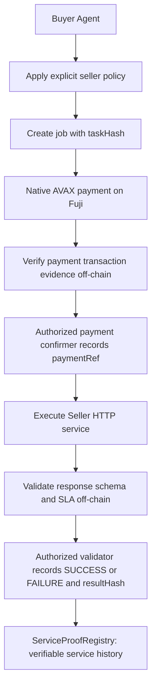

# Proof-of-Service for Agent Commerce

**Bind agent reputation to verifiable economic interactions.**

## Payment ≠ Successful Delivery

Agent reputation and feedback can be disconnected from actual paid interactions. A payment proves money moved; it does not prove that the purchased service satisfied its requirements.

Proof-of-Service binds a paid job, Avalanche payment evidence, service execution evidence, machine-verifiable schema/SLA validation, and an immutable **SUCCESS / FAILURE** outcome into a portable on-chain service history.

The primary interactive proof is **Job #3, completed on Avalanche Fuji**: real wallet payment, measured HTTP 200, 5/6 schema/SLA checks, and a recorded Failure outcome under deterministic fault injection. Refresh its existing proof; do not replay the finalized run. Historical Jobs #1/#2 remain supporting evidence. It is a service-evidence prototype, not a production-ready reputation platform.

## Historical supporting evidence: Jobs #1/#2

Both jobs requested **Weather schema request · Tokyo** under the same task terms. Both used real localhost HTTP transport and real native Fuji AVAX payments.

| Evidence | Job #1 | Job #2 |
| --- | --- | --- |
| Native payment, excluding gas | 0.000001 AVAX | 0.000001 AVAX |
| Payment verifier | VERIFIED · 6 / 6 checks | VERIFIED · 6 / 6 checks |
| HTTP status | 200 | 200 |
| Exact response body | `{"city":"Tokyo","temperatureC":22,"condition":"clear"}` | `{"city":"Tokyo","condition":"clear"}` |
| Measured latency | 77.5971239999999 ms | 62.07374600000185 ms |
| Schema/SLA checks | 6 / 6 PASS | 5 / 6 PASS |
| Failed requirement | None | **temperatureC must be a finite number** |
| Final outcome | **SUCCESS** | **FAILURE** |
| Payment transaction | [Inspect payment #1](https://testnet.snowtrace.io/tx/0xffba988bcbfb5444db011f18e961974fa740d15a4cad996de013346b90dac92b) | [Inspect payment #2](https://testnet.snowtrace.io/tx/0x28521fa0c88172f6ee5d59a87efb853b2400495f3c59118c079764a6def38fc9) |
| Outcome transaction | [Inspect SUCCESS](https://testnet.snowtrace.io/tx/0xd0735337b050c18f4b17c0a4361ece666c4e64754af1a9817bbf809a406a1267) | [Inspect FAILURE](https://testnet.snowtrace.io/tx/0x473c03856ab58b9b6a874f92eb426dd7f9d0a9b2319c2f445a1c04d329ddf950) |
| Outcome block | 58823660 | 58824278 |

**Both jobs were paid. Both returned HTTP 200. Only Job #1 satisfied the machine-verifiable service contract.** The failure is a service-validation failure, not a payment or HTTP transport failure.

Seller A's recorded demo registry totals are **2 paid jobs · 1 successful · 1 failed · 50% success rate**. The dashboard reads current `sellerStats` directly from Fuji, with a “Live from Fuji” indicator and refresh button. RPC failure or an eight-second timeout produces a clearly labeled snapshot, not a broken page. Live totals can change; the historical evidence above does not. Displayed latencies are rounded to three decimals in the dashboard.

## How it works



**Payment proof and service outcome are separate pieces of evidence.** The registry stores commitments and outcomes, not the response body itself. `paymentRef` is the verified payment transaction hash. `taskHash` commits to versioned task terms; `resultHash` commits to the exact raw response body, HTTP status, timing, threshold, and ordered validation results using canonical JSON tuples and keccak256.

The implemented [`E2EPlanner`](server/src/orchestration.ts) prepares unsigned calldata and checks matching registry state after external submissions. It does **not** sign, send AVAX, or broadcast transactions. The recorded Fuji jobs already exist; starting this repository does not create or replay them.

### What the contract guarantees

[`ServiceProofRegistry.sol`](contracts/src/ServiceProofRegistry.sol) enforces:

- `Created → Paid → Success / Failure`: no outcome before payment confirmation.
- A nonzero `paymentRef` cannot be reused across jobs in this registry.
- Only the authorized `paymentConfirmer` can confirm payment; only the authorized `validator` can record an outcome. Only the owner can configure those roles.
- A finalized outcome and its nonzero result hash cannot be overwritten.
- `paidJobs` increments on payment confirmation. `successfulJobs` and `failedJobs` increment exactly once on the corresponding final outcome. These counters reflect registry transitions, not submitted ratings.

**The contract does not autonomously guarantee eventual finalization of every paid job.** It trusts authorized roles to submit truthful payment references and service outcomes; it does not inspect HTTP responses or independently verify transfers.

## MVP trust model

| Layer | Verified or enforced | Boundary |
| --- | --- | --- |
| Off-chain payment verifier | Fuji network, matching transaction/receipt hashes and inclusion block, successful receipt, exact buyer and seller addresses, and minimum native AVAX amount | Trusts RPC data; direct transfers only. No confirmation-depth/reorganization policy or independent cryptographic chain proof. |
| Off-chain HTTP evidence | Actual HTTP response status/body and monotonic elapsed time through full body consumption | Local deterministic demo service; no execution attestation or hard transport deadline. |
| Off-chain schema/SLA validator | HTTP 200, valid JSON, nonempty city, finite numeric `temperatureC`, nonempty condition, and response time strictly below 1000 ms for these demo terms | Does not establish factual weather truth or require returned city equality with requested city. |
| On-chain registry | Role authorization, payment-reference uniqueness, valid transitions, final outcome integrity, seller counters | `paymentConfirmer` and `validator` are trusted roles; no autonomous finalization/liveness guarantee. |

Explicit limitations:

- Weather content is deterministic demo data, not verified real-world weather.
- Historical Jobs #1/#2 shared a buyer/verifier signer. Interactive Job #3 used a buyer wallet and trusted local operator roles; validation remains off-chain and is not decentralized.
- No Sybil-resistance claim and no arbitrary trust score.
- No x402 or ERC-8004 integration in the MVP.
- This is a hackathon prototype, not a production-ready system.

## Buyer policy demo

The dashboard's **Demo selection scenario** uses illustrative pre-purchase history and USD quoted prices. These are **not Fuji registry totals or AVAX/USD conversions**.

Policy: **at least 20 verified jobs · at least 90% success · quoted price at most $0.02**.

| Seller | Demo quoted price | Illustrative jobs | Success / failure | Success rate | Decision |
| --- | --- | --- | --- | --- | --- |
| A · Reliable Weather Agent | $0.01 | 103 | 99 / 4 | 96.1% | Eligible / selected |
| B · Budget Weather Agent | $0.005 | 250 | 153 / 97 | 61.2% | Rejected: success rate |
| C · Unverified Weather Agent | $0.002 | 0 | 0 / 0 | No history | Rejected: insufficient jobs / no verified history |

The [policy implementation](server/src/service.ts) filters raw metrics, then chooses the cheapest eligible seller, breaking price ties by seller ID. The actual historical payments are **0.000001 AVAX each**, independent of these demo quotes.

## Real deployment and evidence references

Network: **Avalanche Fuji · chain ID 43113**. Deployment block: **58822268**.

| Role | Address |
| --- | --- |
| ServiceProofRegistry | [0x442EacAd079CcE0e3671ee0B2eb75c199f36e917](https://testnet.snowtrace.io/address/0x442EacAd079CcE0e3671ee0B2eb75c199f36e917) |
| Owner / deployer | [0x9764b345a014D7Cf08f223e7fF5453916ee15f9B](https://testnet.snowtrace.io/address/0x9764b345a014D7Cf08f223e7fF5453916ee15f9B) |
| Payment confirmer | `0x9764b345a014D7Cf08f223e7fF5453916ee15f9B` |
| Validator | `0x9764b345a014D7Cf08f223e7fF5453916ee15f9B` |
| Seller A payment address | [0x0342ed8eaC11a52C247C9428c450A7288b72f484](https://testnet.snowtrace.io/address/0x0342ed8eaC11a52C247C9428c450A7288b72f484) |

<details>
<summary>Full deployment transactions, job creation/confirmation references, and hashes</summary>

| Deployment action | Transaction |
| --- | --- |
| Deploy registry | [0x123e1f7c4a3dcd7fc8bb0cde4f530a80f9d3f9880322420ba0cf66ecafaae858](https://testnet.snowtrace.io/tx/0x123e1f7c4a3dcd7fc8bb0cde4f530a80f9d3f9880322420ba0cf66ecafaae858) |
| setValidator | [0x3c61d36006126b613e51d2e97439a9f0cc8fe69d998cafb49257a6918e9c0850](https://testnet.snowtrace.io/tx/0x3c61d36006126b613e51d2e97439a9f0cc8fe69d998cafb49257a6918e9c0850) |
| setPaymentConfirmer | [0x591b6d74771ea21280c4b1cc2b19913455b46e9fdbc66881d2bedb235d7bfa6d](https://testnet.snowtrace.io/tx/0x591b6d74771ea21280c4b1cc2b19913455b46e9fdbc66881d2bedb235d7bfa6d) |

Shared taskHash (Jobs #1 and #2):

```text
0xe9cddd83f03f2ffa8a7748045a0447f74b1d71ea153de5387609be3bbd651cc5
```

| Job | Action | Transaction |
| --- | --- | --- |
| 1 | Create | [0x4915f62f6af9419f8e9109439285a88b3e0fcab73cfc9a53b5f5f3ef320931be](https://testnet.snowtrace.io/tx/0x4915f62f6af9419f8e9109439285a88b3e0fcab73cfc9a53b5f5f3ef320931be) |
| 1 | Confirm payment | [0x83c52636b52c4925c498cd138677359727e9e5bde6d18977d7d6b9f742f5f2ad](https://testnet.snowtrace.io/tx/0x83c52636b52c4925c498cd138677359727e9e5bde6d18977d7d6b9f742f5f2ad) |
| 2 | Create | [0x13915ec3747e75a30e6bd712036b235caa2aadc7420d6d07d2b3b5034eed2186](https://testnet.snowtrace.io/tx/0x13915ec3747e75a30e6bd712036b235caa2aadc7420d6d07d2b3b5034eed2186) |
| 2 | Confirm payment | [0xf950b36f8d57e16e39bc779600ca8c1e2c656391158011ee114358d83a4409c2](https://testnet.snowtrace.io/tx/0xf950b36f8d57e16e39bc779600ca8c1e2c656391158011ee114358d83a4409c2) |

Job #1 resultHash:

```text
0x72f7e083b133da6eee43e57323d28103798f147925e28b548e88ff5898961eb5
```

Job #2 resultHash:

```text
0x9e57fabdbce8dd1a18988c4816a10d47726534ac53477eaf0e0b96b964be4589
```

</details>

These are the recorded submission references, not a fresh chain audit performed while writing this README. Explorer URL format matches the existing [frontend configuration](web/src/evidence.ts) and link construction. Full off-chain evidence is needed to reproduce a result hash; the hash alone does not prove the truth of the underlying service report.

## Repository structure

| Directory | Implemented components |
| --- | --- |
| [`contracts/`](contracts/) | Solidity registry, Foundry configuration, unit and fuzz tests. |
| [`server/`](server/) | TypeScript seller policy, deterministic weather API, schema/SLA validation, real HTTP evidence, read-only viem payment/registry helpers, preparation-only orchestration, tests. |
| [`web/`](web/) | React + TypeScript + Vite dashboard; historical proof comparison and live read-only Fuji stats with snapshot fallback. |

## Run locally

Prerequisites: **Node.js 22.12+**, npm, and Foundry (`forge`) for contract tests. Run commands from the repository root. No wallet, credentials, or environment file is needed for the commands below.

```sh
# Install application dependencies
npm --prefix server ci
npm --prefix web ci

# Initialize the declared forge-std submodule, then test contracts locally
git submodule update --init --recursive
forge test --root contracts

# Server checks
npm --prefix server test
npm --prefix server run typecheck

# Dashboard checks
npm --prefix web run build
npm --prefix web run lint
```

Start the deterministic seller server:

```sh
npm --prefix server start
```

It listens on `http://127.0.0.1:3001`; `npm --prefix server run dev` enables watch mode.

In another terminal, start the dashboard:

```sh
npm --prefix web run dev
```

Open the URL Vite prints, normally `http://localhost:5173`. The dashboard works independently of the local server, requires **no wallet connection**, and makes only read-only Fuji RPC calls (`eth_chainId`, `eth_call`). It never submits a transaction.

The mock `/api/demo/success` and `/api/demo/failure` routes use in-process responses with **simulated 10 ms timing and no payments**. Use the HTTP evidence CLI below for real transport and measured timing. See [server documentation](server/README.md) for API and planner details.

## Inspect evidence with the CLIs

With the local server running, collect a new HTTP observation:

```sh
npm --prefix server run --silent evidence:http -- http://127.0.0.1:3001 seller-a Tokyo success 1000
npm --prefix server run --silent evidence:http -- http://127.0.0.1:3001 seller-a Tokyo failure 1000
```

Each invocation makes one GET, without retries or redirect following, and prints status, exact body, measured latency, six SLA checks, canonical result evidence, and `resultHash`. **New measurements produce new evidence and potentially different hashes; they do not reproduce or replace Job #1/#2's historical timing or evidence.** Neither command binds a job, verifies payment, or records an outcome. Even the success scenario can fail the timing threshold.

Read and verify the already-existing Job #2 payment using public inputs:

```sh
npm --prefix server run --silent evidence:payment -- \
  https://api.avax-test.network/ext/bc/C/rpc \
  0x28521fa0c88172f6ee5d59a87efb853b2400495f3c59118c079764a6def38fc9 \
  0x9764b345a014D7Cf08f223e7fF5453916ee15f9B \
  0x0342ed8eaC11a52C247C9428c450A7288b72f484 \
  1000000000000
```

Arguments are RPC URL, transaction hash, expected buyer, expected seller, and minimum amount in wei. The CLI prints `status`, `transactionHash`, `paymentRef`, and checks. Exit code 0 means VERIFIED; rejection or unavailable evidence exits 1. RPC errors do not fabricate evidence. This command does not send AVAX, confirm payment in the registry, or prove service success.

## Tests and validation checkpoints

| Component | Recorded checkpoint | Coverage |
| --- | --- | --- |
| Solidity | 29 / 29 passed, including fuzz coverage | Role authorization, valid transitions, reference reuse, immutable outcomes, seller counters. |
| Server | 68 / 68 passed after the payment evidence CLI checkpoint | Policy, schema/SLA, payment rejection cases, hashing, planner transitions, actual local HTTP transport, CLI behavior. |
| Web | Build and lint passed in the dashboard polish checkpoint | TypeScript/Vite build and ESLint. No web test suite is configured. |

These are recorded development checkpoints supplied with the submission history, not fresh test runs for this documentation change. Current test sources and package scripts were inspected. Server payment tests use mocked clients; HTTP tests use local servers. They do not establish current Fuji availability. Use the commands above to rerun checks.

## Why Avalanche

Fuji provides the shared payment transaction record and proof registry used by this demo. Payment references and final service outcomes are independently inspectable, so seller service history is not held only in the buyer's or seller's application database. The testnet enabled real end-to-end economic interactions with small native AVAX payments.

## Future work — not implemented in this MVP

- Separate verifier roles and explore decentralized validation.
- Stronger anti-Sybil weighting.
- ERC-8004 evidence interoperability.
- An x402-compatible payment flow.
- Additional machine-verifiable service types.
